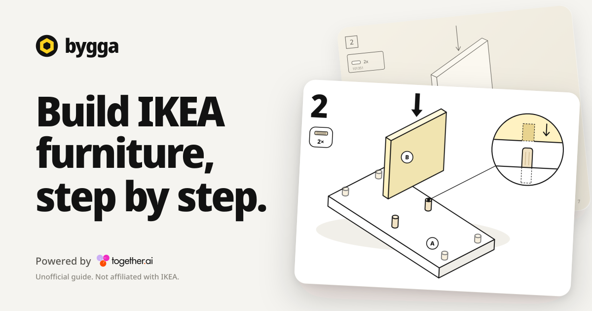

<p align="center">
  
</p>

<h1 align="center">Makan3D</h1>

<p align="center">A browser based 3D room planner for exploring IKEA furniture at true scale, shaping a room, and taking a priced shopping list to IKEA.</p>

## What is built

Makan3D has evolved from the original Bygga assembly-guide product into a room planning workspace. The room planner is the primary experience at `/`.

- Configure a room from 1.2 to 20 metres on each side, choose wall colours and select grid, wood, tile, or concrete flooring.
- Browse thousands of IKEA catalog entries by name, article number, or category. The catalog uses static thumbnails, on demand 3D previews, windowed rendering, keyboard navigation, and responsive mobile sheets so it stays practical at large catalog sizes.
- Add supported furniture to the scene, select it, move it with transform controls, rotate it, and keep every item within the room boundaries.
- Change exposure, ambient light, and HDR environment presets. Cinematic mode clears the controls and slowly rotates the camera for a clean presentation view.
- See a live GBP estimate grouped by product and quantity. Checkout opens a safe IKEA UK search containing the selected article numbers.
- Export and import complete layouts as validated JSON, or download the current room as a PNG.
- Use the room planner on desktop and mobile, with touch-aware controls, bottom sheets, focus management, reduced-motion support, and labelled controls throughout.

The original Bygga guide system remains in the codebase and is still available through the build routes. It generates original, IKEA-manual-inspired 3D assembly guides, print views, share images, optional scanner flows, help, feedback, and voice interaction. We do not copy IKEA manuals, illustrations, photos, or prose.

## Architecture

```text
Browser
  |
  +-- Next.js App Router UI
  |     +-- Room configuration, catalog, estimate, import and export controls
  |     +-- Zustand room state and Zod validation
  |     +-- React Three Fiber scene, Drei controls, HDR environments and GLB models
  |
  +-- Route handlers
  |     +-- IKEA checkout search handoff
  |     +-- Legacy guide, help, voice, scanner, feedback and key endpoints
  |
  +-- Static project data
        +-- Catalog metadata, prices, model availability and GLB assets
        +-- Parametric guide specifications and generated voice clips
```

## Technology stack

- Next.js 16 with the App Router, Cache Components, partial prefetching, React 19, TypeScript, and ESLint.
- React Three Fiber, Drei, and Three.js for the interactive room, camera navigation, transform controls, GLB furniture, and HDR lighting.
- Zustand for client-side room state, Zod for import validation, and Motion for UI transitions.
- Tailwind CSS, shadcn-style local primitives, and custom CSS for the responsive interface. There is no hosted component runtime required by the app.
- Git LFS for versioned `public/models/*.glb` assets.
- Vercel Analytics and Plausible, proxied through the site, plus a service worker for the legacy guide experience.
- Together AI for opt-in legacy AI features. Recorded and live narration use Kokoro `af_heart` only.

## Project structure

| Location | Responsibility |
| --- | --- |
| `src/app` | Pages, metadata, route handlers, service routes, and App Router configuration |
| `src/components` | Room planner interface, Three.js scene components, mobile UI, and legacy guide UI |
| `src/store/useRoomStore.ts` | Room state, item placement constraints, and JSON layout validation |
| `src/data/room-catalog.json` | Shipping furniture metadata used by the room planner |
| `public/models` | IKEA furniture GLB files, tracked with Git LFS |
| `public/environments` | HDR environment maps used for room lighting |
| `src/lib/plan` | Original parametric assembly-guide generator |
| `scripts` | Catalog, price, model, voice, and guide data maintenance tools |
| `docs` | Manual product checks and model audit notes |

## Catalog and data policy

The planner currently ships metadata for 7,020 catalog products, with 3,047 available 3D models. Catalog filtering only exposes entries that have an available model, so every item users add can render in the room.

IKEA source listings are used as input to local build scripts only. Raw listing dumps and caches are deliberately excluded from Git. The app ships the generated product rows, its own drawings, and its own guide copy. IKEA names and trademarks remain the property of Inter IKEA Systems B.V.

## Local development

### Prerequisites

- Node.js 20 or later
- npm
- Git LFS, required to obtain the furniture models

### Setup

```bash
git clone https://github.com/Nutlope/bygga.git
cd bygga
git lfs install
git lfs pull
npm install
npm run dev
```

Open [http://localhost:3000](http://localhost:3000) to use the room planner.

### Environment variables

Copy the example file when developing optional AI and feedback capabilities:

```bash
cp .env.example .env.local
```

`TOGETHER_API_KEY` is only needed for the legacy AI, speech recognition, scanner, and guide-generation paths. Room planning, local catalog browsing, layout import and export, scene capture, and IKEA search handoff work without it. See [`.env.example`](.env.example) for model selection, Upstash feedback, site URL, and scanner settings.

## Commands

| Command | Purpose |
| --- | --- |
| `npm run dev` | Start the development server |
| `npm run build` | Check model availability, then create a production build |
| `npm run start` | Serve the production build |
| `npm run lint` | Run ESLint |
| `npm run ikea:fetch` | Fetch IKEA listing inputs for catalog maintenance |
| `npm run ikea:measure` | Measure catalog dimensions |
| `npm run ikea:build` | Build generated IKEA product rows and plans |
| `npm run ikea:check` | Validate the generated catalog |
| `npm run models:scrape` | Refresh model availability metadata |
| `npm run prices:scrape` | Refresh price metadata |
| `npm run voice` | Record legacy narration clips with Kokoro `af_heart` |
| `npm run voice:check` | Replay legacy voice-listening checks |
| `npm run feedback` | Read locally collected feedback |

Before submitting a change, run:

```bash
npm run lint
npm run build
```

## Design and quality notes

- The main workspace gives the 3D scene priority, with room configuration on the left and the furniture catalog on the right at desktop widths.
- Long catalog lists are virtualized and every result can be explored by keyboard.
- Imported layouts are schema-checked, must use valid room sizes, unique item IDs, finite transforms, and furniture positions that stay inside the room.
- The site uses a self-only content security policy, strict response headers, and explicit camera and microphone permissions for the legacy optional flows.
- Share images, print views, the service worker, and build-guide voice capabilities belong to the retained Bygga platform.

## License and trademark notice

MIT, see [LICENSE](LICENSE). Makan3D and the retained Bygga guide features are not affiliated with IKEA. IKEA and its product names are trademarks of Inter IKEA Systems B.V. The license grants no rights to those marks. See [NOTICE](NOTICE).
